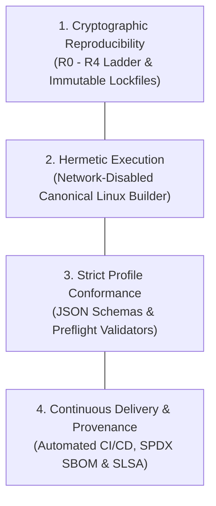
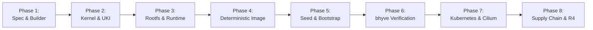
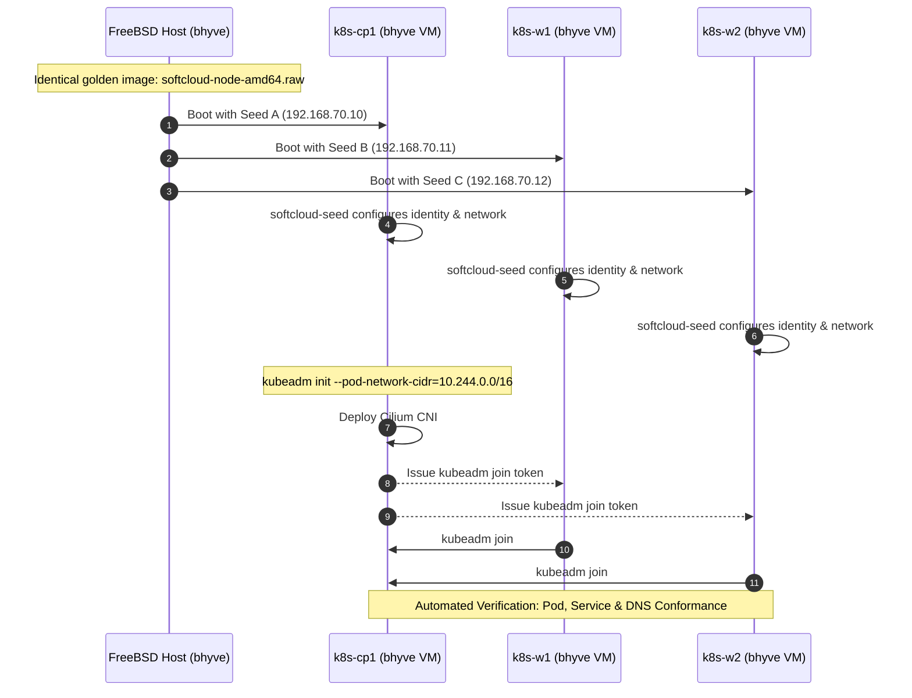
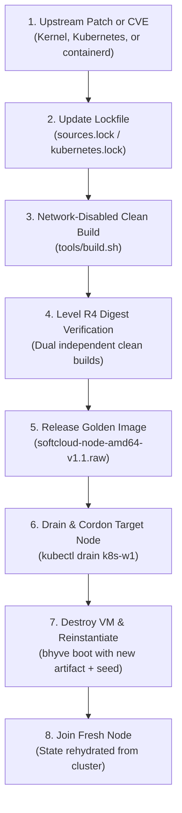

# SoftCloud Node Linux Adoption Plan

**Document:** `ADOPTION_PLAN.md`  
**Baseline Specification:** `SOFTCLOUD-NODE-LINUX-1.0` ([MEMORANDUM.md](memorandum.md))  
**Governing Organization:** Software Cloud (`soft-cloud-dev`)  
**Artifact Producer:** `soft-cloud-dev/os-linux`  
**Consumer Platform:** `soft-cloud-dev/freebsd-laboratory`  
**Target Environment:** FreeBSD `bhyve` on `amd64`  
**Status:** Normative Implementation & Rollout Plan

---

## 1. Executive Summary & Objective

The objective of this Adoption Plan is to transition the Software Cloud infrastructure and laboratory environments from mutable, general-purpose Linux installations to the normative, deterministic **SoftCloud Node Linux 1.0** operating system baseline.

SoftCloud Node Linux enforces a fundamental architectural invariant:

$$\text{The machine changes; the operating-system artifact does not.}$$

All cluster state, machine identity, network addressing, and dynamic workload storage are decoupled from the OS release artifact (`softcloud-node-amd64.raw`). By adhering to the established rules of the Software Cloud organization, this plan provides a phased, verifiable, and risk-mitigated path to full operational adoption.

---

## 2. Alignment with Organizational Rules and Governance

The Software Cloud engineering philosophy is codified across four core pillars and strict governance constraints. Every phase of this adoption plan is mapped directly to these principles.

### 2.1 The Four Foundational Pillars



1. **Cryptographic Reproducibility**:
   - Every build input resolves to an exact cryptographic digest.
   - No floating tags (`latest`, `stable`, `main`, `master`) are permitted in accepted builds (`SN-01`, `SN-02`).
   - The production release requires Level **R4** reproducibility: two independent, clean builds must yield bit-identical raw image checksums (`REP-03`).

2. **Hermetic Execution**:
   - Strict separation between the network-dependent `FETCH` phase and the offline `BUILD` phase (`BUILD-01` through `BUILD-05`).
   - The canonical builder executes in an isolated Linux environment targeting CPython 3.12.14, Linux LTS 6.18, and pinned toolchains with external network access disabled (`SN-31`).

3. **Strict Profile Conformance**:
   - Formal schema contracts govern every boundary:
     - `softcloud.os/v1`: Kernel and distribution profile declarations.
     - `softcloud.node/v1`: Machine bootstrap and seed interface.
     - `softcloud.artifact/v1`: Artifact manifest and release metadata.
   - Automated preflight tools (`tools/check_profile.py`, schema validators) fail closed upon any deviation.

4. **Continuous Delivery & Formal Provenance**:
   - Every artifact is published with an SPDX JSON Software Bill of Materials (SBOM), cryptographic provenance manifest (`provenance.json`), and SHA-256 digest manifest (`SHA256SUMS`).
   - Automated deployment to [linux.softcloud.dev](https://linux.softcloud.dev/) via GitHub Actions.

### 2.2 System Boundary Invariants

The division of ownership between `os-linux` and `freebsd-laboratory` is immutable:

- **`ARCH-01`**: Kubernetes cluster state SHALL NOT be embedded in the release artifact.
- **`ARCH-02`**: A single golden image SHALL serve interchangeably as control-plane or worker node.
- **`ARCH-03`**: Machine-specific identity SHALL be supplied or generated post-instantiation.
- **`ARCH-04`**: Cluster identity SHALL be established only by the cluster bootstrap process.

### 2.3 Change Control Classification

In accordance with Section 31 of the memorandum:

- **Architectural Changes**: Modifications to trust boundaries, storage topology, boot contract, or bootstrap schema require formal revision and re-ratification of `MEMORANDUM.md`.
- **Baseline Changes**: Upgrades to Linux LTS, Kubernetes patch versions, containerd, or Debian snapshot timestamps require lockfile updates and full rerun of acceptance criteria `SN-01` through `SN-35`.
- **Implementation Changes**: Internal script optimizations or refactoring may proceed without specification revision provided all normative test gates pass.

---

## 3. Phased Adoption Roadmap

Adoption proceeds across eight sequential phases, matching the dependency order specified in Section 28 of the memorandum. Each phase contains explicit deliverables, ownership assignments, and mandatory acceptance gates.



---

### Phase 1 — Specification Baseline, Schemas & Canonical Builder

**Objective**: Establish the immutable specification baseline, formal JSON schemas, canonical Linux container builder, and pinned toolchain lockfile.

#### Key Deliverables
1. **Ratification of Baseline**: Freeze `MEMORANDUM.md` (`SOFTCLOUD-NODE-LINUX-1.0`) as normative law.
2. **Schema Definitions**:
   - `schemas/softcloud.os.v1.schema.json`
   - `schemas/softcloud.node.v1.schema.json`
   - `schemas/softcloud.artifact.v1.schema.json`
3. **Canonical Linux Builder**:
   - Docker/OCI containerfile specifying Ubuntu 24.04 x86-64 base with exact versions of `gcc`, `binutils`, `pahole`, `mmdebstrap`, `systemd-boot`, `mke2fs`, and `dosfstools`.
4. **Toolchain Lock**:
   - Generate `locks/toolchain.lock` containing cryptographic digests of all builder utilities.

#### Verification Gates
- **`SN-01`**: All toolchain binaries and container layers cryptographically digested.
- **`SN-02`**: Zero unpinned floating references across builder definitions.

---

### Phase 2 — Kernel LTS, eBPF/BTF & Deterministic UKI

**Objective**: Construct the dedicated bhyve Linux LTS kernel with complete eBPF/BTF capabilities and assemble the bit-deterministic Unified Kernel Image (`BOOTX64.EFI`).

#### Key Deliverables
1. **Sources Lock**:
   - Pin Linux 6.18 LTS source tarball and cryptographic SHA-256 hash in `locks/sources.lock`.
2. **Kernel Configuration**:
   - Implement `kernel/config/linux-kubernetes-bhyve.config` with built-in:
     - `CONFIG_VIRTIO=y`, `CONFIG_VIRTIO_PCI=y`, `CONFIG_VIRTIO_BLK=y`, `CONFIG_EXT4_FS=y`
     - Cgroup v2 controllers (`CONFIG_CGROUPS=y`, `CONFIG_MEMCG=y`, `CONFIG_CGROUP_BPF=y`)
     - eBPF subsystem (`CONFIG_BPF=y`, `CONFIG_BPF_SYSCALL=y`, `CONFIG_BPF_JIT=y`, `CONFIG_BPF_EVENTS=y`)
     - Routing & Cilium requirements (`CONFIG_NET_CLS_ACT=y`, `CONFIG_NET_ACT_BPF=y`, `CONFIG_LWTUNNEL_BPF=y`, `CONFIG_VXLAN=y`)
     - Bridge & Netfilter (`CONFIG_VETH=y`, `CONFIG_BRIDGE=y`, `CONFIG_NF_CONNTRACK=y`, `CONFIG_NETFILTER_XT_TARGET_TPROXY=y`)
     - Disabled swap (`CONFIG_SWAP=n`)
3. **BTF Generation & Verification**:
   - Compile kernel with `CONFIG_DEBUG_INFO_BTF=y` using pinned `pahole`.
   - Automated preflight execution:
     ```sh
     bpftool btf dump file build/vmlinux format raw >/dev/null
     ```
4. **Deterministic UKI Construction**:
   - Combine systemd-boot EFI stub, kernel binary (`vmlinux`), minimal initramfs, and kernel command line:
     ```text
     root=PARTUUID=8f509e5b-3b32-4e4b-9f93-01362e92c002 rootfstype=ext4 rootwait console=ttyS0,115200 cgroup_no_v1=all
     ```
   - Derive PE/COFF header timestamps from `SOURCE_DATE_EPOCH`.

#### Verification Gates
- **`SN-03`**: Kernel source matches `sources.lock`.
- **`SN-04`**: EDK2 boot contract satisfied without persistent NVRAM.
- **`SN-05`**: BTF section present and parsed cleanly by `bpftool`.
- **`SN-06`**: CPU mitigations active.
- **`SN-19`**: Serial console on `ttyS0,115200` operational.
- **`SN-32`**: Bit-identical UKI digests produced across independent builds with identical `SOURCE_DATE_EPOCH`.

---

### Phase 3 — Immutable Userspace & Runtime Assembly

**Objective**: Assemble the Debian 13 snapshot root filesystem via `mmdebstrap`, apply the SoftCloud distribution overlay, install locked container/Kubernetes binaries, and sequence early bpffs mount propagation.

#### Key Deliverables
1. **Debian Snapshot Lock**:
   - Select and record immutable Debian 13 snapshot archive in `locks/debian.lock`.
2. **Hermetic Rootfs Pipeline**:
   - Execute `mmdebstrap` in unshare/chroot mode.
   - Run `ldconfig -r <target-root>` to pre-cache shared libraries deterministically (`USR-06`, `USR-07`).
3. **OS Distribution Identity**:
   - Establish `/etc/os-release` identifying the OS as `SoftCloud Node Linux 1.0` (`ID-01`, `ID-02`).
4. **Container & Kubernetes Runtimes**:
   - Install pinned binaries from `locks/containerd.lock` (`containerd`, `runc`) and `locks/kubernetes.lock` (`kubelet`, `kubeadm`, `kubectl`, `crictl`).
   - Place CNI loopback reference binary at `/opt/cni/bin/loopback` (`RUN-06`).
   - Configure `containerd` and `kubelet` to utilize the `systemd` cgroup driver (`RUN-02`, `RUN-03`).
5. **Early bpffs Shared Mount Unit**:
   - Implement `sys-fs-bpf.mount` and companion unit ensuring `/sys/fs/bpf` is mounted as `bpf` with `rshared` propagation before containerd and kubelet launch:
     ```ini
     [Unit]
     Description=BPF Shared Filesystem Mount
     DefaultDependencies=no
     Before=containerd.service kubelet.service

     [Service]
     Type=oneshot
     RemainAfterExit=yes
     ExecStart=/bin/mount -t bpf bpffs /sys/fs/bpf
     ExecStart=/bin/mount --make-rshared /sys/fs/bpf
     ```

#### Verification Gates
- **`SN-07`**: Package closure fully represented in `debian.lock`.
- **`SN-08`**: Distribution identifies as SoftCloud Node Linux.
- **`SN-09`**: PID 1 is systemd.
- **`SN-10`**: Unified cgroup v2 hierarchy active.
- **`SN-11`**: `containerd` CRI socket functional (`crictl info`).
- **`SN-12`**: Systemd cgroup driver enforced across runtimes.
- **`SN-13`**: Swap verified absent or inactive.
- **`SN-14`**: IP forwarding (`net.ipv4.ip_forward = 1`) active.
- **`SN-22`**: `kubeadm` preflight checks succeed; `/opt/cni/bin/loopback` present.
- **`SN-33`**: `/sys/fs/bpf` verified as type `bpf` with `shared` propagation before runtime launch.

---

### Phase 4 — Deterministic Storage Layout & State Projection

**Objective**: Implement the 3-partition GPT layout, deterministic filesystem generation, `systemd-repart` auto-growth, and systemd bind mounts for mutable node state.

#### Key Deliverables
1. **Partition Specification**:
   ```text
   +---------------+--------------------------------------+--------------------------------------+
   | Partition     | Type GUID                            | Purpose / Mount                      |
   +---------------+--------------------------------------+--------------------------------------+
   | p1 (ESP)      | C12A7328-F81F-11D2-BA4B-00A0C93EC93B | FAT32 (512 MiB), /EFI/BOOT/BOOTX64.EFI|
   | p2 (OS Root)  | 0FC63DAF-8483-4772-8E79-3D69D8477DE4 | ext4 (4 GiB), Deterministic UUID     |
   | p3 (Node State| 0FC63DAF-8483-4772-8E79-3D69D8477DE4 | ext4 (Dynamic), /var/mnt/state       |
   +---------------+--------------------------------------+--------------------------------------+
   ```
2. **Deterministic ext4 Formatting**:
   - Root filesystem compiled with deterministic inode table, fixed UUID, and disabled journal randomness:
     ```sh
     mke2fs -d rootfs/ -t ext4 -O ^has_journal,dir_index \
       -U "8f509e5b-3b32-4e4b-9f93-01362e92c002" \
       -E nodiscard,lazy_itable_init=0,lazy_journal_init=0 root.img
     ```
3. **Dynamic State Growth (`systemd-repart`)**:
   - Provide `/usr/lib/repart.d/50-node-state.conf`:
     ```ini
     [Partition]
     Type=linux-generic
     Label=node-state
     Format=ext4
     MountPoint=/var/mnt/state
     GrowFileSystem=yes
     ```
4. **State Bind Mount Units**:
   - Implement systemd `.mount` units projecting mutable directories from `p3` into standard locations before dependent services start:
     - `/var/mnt/state/containerd` $\to$ `/var/lib/containerd`
     - `/var/mnt/state/kubelet` $\to$ `/var/lib/kubelet` (`rshared`)
     - `/var/mnt/state/etcd` $\to$ `/var/lib/etcd`
     - `/var/mnt/state/log` $\to$ `/var/log`
   - Explicitly forbid symbolic links (`LAYOUT-02`).

#### Verification Gates
- **`SN-17`**: Root disk functional over bhyve VirtIO block.
- **`SN-34`**: Mutable state paths confirmed as actual mount points (not symlinks) bind-mounted from `p3`.

---

### Phase 5 — Machine Bootstrap Subsystem (`softcloud-seed`)

**Objective**: Implement the `softcloud.node/v1` machine bootstrap engine, device-unit activation, fail-closed validation, and one-shot persistent state marking.

#### Key Deliverables
1. **Bootstrap Engine (`softcloud-seed`)**:
   - Lightweight, standalone binary installed to `/usr/lib/softcloud/softcloud-seed`.
   - Validates seed payload strictly against `schemas/softcloud.node.v1.schema.json`.
   - Applies hostname, network configuration (`systemd-networkd`), and SSH authorized keys (`/root/.ssh/authorized_keys`).
2. **Systemd Service Ordering**:
   - Unit `softcloud-seed.service` activates on `dev-disk-by\x2dlabel-CIDATA.device` without relying on `systemd-udev-settle`:
     ```ini
     [Unit]
     Description=SoftCloud Seed Initializer
     DefaultDependencies=no
     Requires=dev-disk-by\x2dlabel-CIDATA.device var-mnt-state.mount
     After=dev-disk-by\x2dlabel-CIDATA.device var-mnt-state.mount local-fs.target
     Before=sysinit.target systemd-networkd.service sshd.service

     [Service]
     Type=oneshot
     RemainAfterExit=yes
     ExecStart=/usr/lib/softcloud/softcloud-seed --mount /dev/disk/by-label/CIDATA
     StandardOutput=journal+console
     ```
3. **One-Shot Initialization Marker (`SN-35`)**:
   - Upon successful execution, writes `/var/mnt/state/.softcloud/seed-initialized` containing schema version, seed SHA-256 digest, and timestamp.
   - On subsequent boots, if CIDATA volume remains attached with identical digest, initialization is skipped.
   - If attached seed has a different digest, the service halts with an identity mismatch diagnostic, failing closed.
4. **Machine Identity Normalization**:
   - Verify `/etc/machine-id` is empty in release artifact (`MID-01`).
   - Systemd generates unique ID on first boot (`MID-02`).
   - SSH host keys generated on first boot (`MID-04`).

#### Verification Gates
- **`SN-15`**: Fresh VM clones produce distinct machine IDs:
  $$\text{machine-id}(cp1) \neq \text{machine-id}(w1) \neq \text{machine-id}(w2)$$
- **`SN-18`**: Network interfaces operate over bhyve VirtIO net.
- **`SN-20`**: Schema validation enforced; invalid seeds fail closed.
- **`SN-21`**: SSH accepts key-based authentication; password root login disabled.
- **`SN-35`**: Persistent marker prevents repeated configuration; changed seed rejects execution.

---

### Phase 6 — FreeBSD `bhyve` Integration & Hardware Virtualization

**Objective**: Validate real-world hardware virtualization execution under FreeBSD `bhyve` using headless EDK2 firmware.

#### Key Deliverables
1. **Laboratory VM Harness**:
   - Configuration scripts in `freebsd-laboratory` to spawn bhyve VMs using:
     - EDK2 UEFI firmware (`BHYVE_UEFI.fd`) with stateless NVRAM.
     - VirtIO block attached to `softcloud-node-amd64.raw`.
     - VirtIO network attached to FreeBSD bridge/TAP.
     - Attached CIDATA ISO/FAT volume.
     - Serial console redirected to UNIX socket or stdio (`ttyS0`).
2. **First-Boot Conformance Suite**:
   - Automated test runner verifying:
     - Clean EDK2 kernel load without NVRAM variables (`SN-16`).
     - Kernel log output on `ttyS0` (`SN-19`).
     - Dynamic expansion of `p3` to allocated disk boundary (`STATE-01`).
     - Correct bind mounting of `/var/lib/containerd`, `/var/lib/kubelet`, `/var/log` (`SN-34`).
     - Proper bpffs mounting and `rshared` propagation (`SN-33`).

#### Verification Gates
- **`SN-16`**: Direct UKI boot under bhyve without persistent boot entries.
- **`SN-17`**: VirtIO block driver stability under I/O load.
- **`SN-18`**: VirtIO network driver packet exchange.
- **`SN-19`**: Serial console operational.

---

### Phase 7 — Kubernetes Cluster Conformance & Cilium Validation

**Objective**: Execute end-to-end multi-node Kubernetes cluster formation and Cilium CNI verification across three bhyve VMs instantiated from the identical OS artifact.



#### Key Deliverables
1. **Cluster Bootstrap**:
   - Initialize `k8s-cp1` using `kubeadm init`.
   - Deploy Cilium CNI targeting native eBPF routing.
   - Join worker nodes `k8s-w1` and `k8s-w2` via `kubeadm join`.
2. **Network Conformance Suite**:
   - Verify Cilium health: `cilium status --wait`.
   - Verify cross-node Pod-to-Pod communication across TAP bridges (`SN-25`).
   - Verify ClusterIP Service load balancing (`SN-26`).
   - Verify CoreDNS resolution for internal service names (`SN-27`).

#### Verification Gates
- **`SN-23`**: Clean worker node join without manual intervention.
- **`SN-24`**: Cilium reports 100% healthy status.
- **`SN-25`**: Pod communication passes connectivity test.
- **`SN-26`**: Service routing functional.
- **`SN-27`**: CoreDNS operational.

---

### Phase 8 — Supply Chain, Provenance & Reproducibility Verification

**Objective**: Enforce the build trust boundary, generate complete SBOM and provenance records, validate Level R4 reproducibility, and publish the release.

#### Key Deliverables
1. **Network-Disabled Build Audit (`BUILD-03`)**:
   - Execute the entire compilation, rootfs assembly, UKI generation, and raw disk construction in a container sandbox with external networking severed.
2. **Software Bill of Materials (SBOM)**:
   - Generate `artifacts/<release>/sbom.spdx.json` enumerating all kernel, userspace, and runtime packages with upstream hashes (`SUP-01`, `SUP-02`).
3. **Cryptographic Build Provenance**:
   - Generate `artifacts/<release>/provenance.json` detailing builder identity, git commit SHA, lockfile digests, and `SOURCE_DATE_EPOCH` (`SUP-03` through `SUP-07`).
4. **Artifact Manifest**:
   - Produce `artifacts/<release>/artifact-manifest.json` validated against `schemas/softcloud.artifact.v1.schema.json` (`SN-29`).
5. **R4 Reproducibility Proof**:
   - Execute two independent clean builds on separate build agents.
   - Compare SHA-256 digests of `softcloud-node-amd64.raw` and `BOOTX64.EFI`:
     $$\text{SHA256}(\text{Image}_A) == \text{SHA256}(\text{Image}_B)$$

#### Verification Gates
- **`SN-28`**: Valid SPDX SBOM generated.
- **`SN-29`**: Artifact manifest adheres strictly to `softcloud.artifact/v1`.
- **`SN-30`**: Clean rebuild meets declared reproducibility level.
- **`SN-31`**: Offline build succeeds without external network.

---

## 4. Acceptance Criteria Verification Matrix

The following matrix maps every normative requirement (`SN-01` through `SN-35`) to its validating phase, test method, and automated CI gate:

| Criterion ID | Requirement Summary | Phase | Verification Method | Automated CI/Gate |
| :--- | :--- | :---: | :--- | :--- |
| **`SN-01`** | Verified Inputs | 1 | Cryptographic hash check against lockfiles | `validate-locks.py` |
| **`SN-02`** | No Moving Inputs | 1 | Regex audit of dependency files | `check-unpinned.sh` |
| **`SN-03`** | Kernel Source Match | 2 | SHA-256 verification of kernel tarball | `verify-sources.sh` |
| **`SN-04`** | Boot Configuration | 2 | EDK2 headless boot test in bhyve | `test-edk2-boot.sh` |
| **`SN-05`** | Cilium/BTF Conformance | 2 | `bpftool btf dump file vmlinux` | `verify-btf.sh` |
| **`SN-06`** | CPU Mitigations | 2 | Kernel config audit (`CONFIG_PAGE_TABLE_ISOLATION=y`, etc.) | `audit-mitigations.py` |
| **`SN-07`** | Package Closure | 3 | Verification against `debian.lock` | `check-closure.py` |
| **`SN-08`** | OS Identity | 3 | Parse `/etc/os-release` for `SoftCloud Node Linux` | `test-os-release.sh` |
| **`SN-09`** | Init is systemd | 3 | Assert `/sbin/init` points to systemd | `test-init.sh` |
| **`SN-10`** | cgroup v2 Hierarchy | 3 | Inspect `/sys/fs/cgroup` mount type | `test-cgroups.sh` |
| **`SN-11`** | CRI Endpoint | 3 | `crictl info` socket query | `test-cri.sh` |
| **`SN-12`** | systemd Cgroups | 3 | Inspect containerd & kubelet configs | `test-cgroup-driver.sh` |
| **`SN-13`** | Swap Disabled | 3 | `swapon --show` empty | `test-swap.sh` |
| **`SN-14`** | IP Forwarding | 3 | `sysctl net.ipv4.ip_forward == 1` | `test-sysctl.sh` |
| **`SN-15`** | Unique Machine Identity | 5 | Diff `/etc/machine-id` across 3 test VMs | `test-machine-id.sh` |
| **`SN-16`** | bhyve Direct Boot | 6 | Boot UKI without persistent NVRAM | `test-bhyve-boot.sh` |
| **`SN-17`** | VirtIO Block Root | 6 | Read/write stress test on `/` | `test-virtio-blk.sh` |
| **`SN-18`** | VirtIO Network | 6 | Packet transmission over VirtIO net | `test-virtio-net.sh` |
| **`SN-19`** | Serial Console | 2, 6 | Verify serial capture on `ttyS0` | `test-serial.sh` |
| **`SN-20`** | Seed Schema Validation | 5 | Assert fail-closed on corrupt seed | `test-seed-schema.sh` |
| **`SN-21`** | SSH Key Authentication | 5 | SSH login via seed key; password rejected | `test-ssh-auth.sh` |
| **`SN-22`** | kubeadm Preflight | 3 | `kubeadm init phase preflight` | `test-kubeadm-preflight.sh` |
| **`SN-23`** | Kubernetes Join | 7 | Worker nodes join cluster successfully | `test-k8s-join.sh` |
| **`SN-24`** | Cilium Health | 7 | `cilium status --wait` passes | `test-cilium.sh` |
| **`SN-25`** | Pod Connectivity | 7 | Cross-node ping between test pods | `test-pod-net.sh` |
| **`SN-26`** | Service Connectivity | 7 | Curl ClusterIP service from worker pod | `test-service-net.sh` |
| **`SN-27`** | CoreDNS Resolution | 7 | Resolve `kubernetes.default.svc.cluster.local` | `test-dns.sh` |
| **`SN-28`** | SPDX SBOM Present | 8 | Validate `sbom.spdx.json` schema | `verify-sbom.py` |
| **`SN-29`** | Artifact Manifest Contract | 8 | Validate against `softcloud.artifact/v1` | `verify-manifest.py` |
| **`SN-30`** | Clean Reproducibility | 8 | Independent rebuild digest match | `verify-repro.sh` |
| **`SN-31`** | Network-Isolated Build | 8 | Canonical build with network disabled | `build-offline.sh` |
| **`SN-32`** | Deterministic UKI | 2 | Compare UKI digests with fixed timestamp | `test-uki-repro.sh` |
| **`SN-33`** | bpffs Shared Propagation | 3 | Check `/sys/fs/bpf` mount & shared flag | `test-bpffs.sh` |
| **`SN-34`** | State Projection (Bind Mounts) | 4 | Confirm mount points on `p3` (no symlinks) | `test-state-mounts.sh` |
| **`SN-35`** | Seed One-Shot Semantics | 5 | Confirm marker prevents rerun; mismatch fails | `test-seed-oneshot.sh` |

---

## 5. Operational Runbook & Cluster Bootstrap Protocol

This protocol defines the standard operational procedure for deploying a 3-node Kubernetes cluster inside `freebsd-laboratory` using the golden release image.

### 5.1 Host Prerequisites (FreeBSD)

1. Ensure bhyve kernel modules and networking are configured:
   ```sh
   kldload vmm nmdm if_tap if_bridge
   sysctl net.link.tap.up_on_open=1
   ```
2. Create the private VM bridge:
   ```sh
   ifconfig bridge0 create
   ifconfig bridge0 inet 192.168.70.1/24 up
   ```

### 5.2 Generating CIDATA Seed Images

For each node (`k8s-cp1`, `k8s-w1`, `k8s-w2`), generate a FAT/ISO image labeled `CIDATA` containing `softcloud.yaml`:

```yaml
# softcloud.yaml (for k8s-w1)
schema: softcloud.node/v1

identity:
  hostname: k8s-w1

network:
  interface: eth0
  address: 192.168.70.11/24
  gateway: 192.168.70.1
  dns:
    - 192.168.70.1

ssh:
  authorized_keys:
    - ssh-ed25519 AAAAC3NzaC1lZDI1NTE5AAAAIExampleLaboratoryKeyAdminUser
```

Create the seed filesystem:
```sh
makefs -t msdos -o label=CIDATA seed-w1.img softcloud.yaml
```

### 5.3 Launching bhyve VM Instances

Instantiate nodes by cloning the golden release image (or creating ZFS snapshot clones):

```sh
# Clone raw disk to allocate 30GB virtual disk
zfs clone tank/images/softcloud-node-amd64@1.0 tank/vms/k8s-w1-disk
truncate -s 30G /dev/zvol/tank/vms/k8s-w1-disk

# Launch bhyve instance
bhyve -c 4 -m 8G -H -P \
  -s 0:0,hostbridge \
  -s 1:0,lpc \
  -s 2:0,virtio-blk,/dev/zvol/tank/vms/k8s-w1-disk \
  -s 3:0,virtio-blk,seed-w1.img \
  -s 4:0,virtio-net,tap1 \
  -l com1,/dev/nmdm_w1A \
  -l bootrom,/usr/local/share/uefi-firmware/BHYVE_UEFI.fd \
  k8s-w1
```

Upon boot:
1. EDK2 loads `/EFI/BOOT/BOOTX64.EFI` from `p1`.
2. Linux boots, recognizing root partition via PARTUUID on `p2`.
3. `systemd-repart` expands `p3` to fill the remaining 26GB and mounts it at `/var/mnt/state`.
4. `softcloud-seed` activates from `dev-disk-by-label-CIDATA.device`, applies IP `192.168.70.11`, sets hostname `k8s-w1`, installs SSH keys, and writes the initialization marker.

---

## 6. Immutable Upgrade & Maintenance Model

SoftCloud Node Linux strictly adheres to the principle of **Artifact Replacement over In-Place Mutation** (`UPG-01` through `UPG-04`):



- **Prohibition of In-Place Upgrades**: Administrators SHALL NOT execute `apt upgrade`, `apt-get install`, or interactive package modifications on running nodes (`UPG-04`).
- **Cluster State Preservation**: Because workload and cluster state reside either in distributed etcd or on ephemeral dynamic state partitions, replacing a node requires zero backup restoration of the OS partition.

---

## 7. Risk Management and Contingency Protocols

| Risk Scenario | Impact | Likelihood | Mitigation Strategy |
| :--- | :--- | :---: | :--- |
| **BTF Generation Failure** | Kernel boots but Cilium fails to attach eBPF programs (`SN-05`). | Low | Builder pins exact `pahole` version in `toolchain.lock`; preflight validation runs `bpftool btf dump` to abort build early. |
| **Seed Mismatch / Reconfiguration Race** | Accidental reconfiguration of production node on reboot (`SN-35`). | Low | Persistent marker `/var/mnt/state/.softcloud/seed-initialized` records seed digest; differs fail closed. |
| **State Disk Exhaustion** | Large container images fill `p3` state partition. | Medium | Initial virtual disk capacity set to $\ge 30$ GiB; `systemd-repart` dynamically claims all unpartitioned disk space. |
| **Non-Deterministic UKI Header** | Build fails Level R2/R4 reproducibility verification (`BOOT-07`, `SN-32`). | Medium | Build runner derives PE/COFF header timestamps strictly from `SOURCE_DATE_EPOCH` and normalizes sections. |
| **Unintended Network Leak during Build** | Build succeeds locally but fails offline audit (`BUILD-03`, `SN-31`). | Low | Canonical Linux builder executes with container network namespace severed (`--network=none`). |

---

## 8. Completion & Conformance Sign-Off

The adoption of SoftCloud Node Linux 1.0 reaches completion when:

```text
one locked OS definition (os.yaml + locks/)
        ↓
one network-isolated canonical build
        ↓
one deterministic UKI (BOOTX64.EFI)
        ↓
one reproducible bhyve raw image (softcloud-node-amd64.raw)
        ↓
three independently instantiated machines (k8s-cp1, k8s-w1, k8s-w2)
        ↓
three unique machine identities
        ↓
persistent node-state bind mounts (/var/lib/containerd, kubelet, etcd, log)
        ↓
shared node bpffs (/sys/fs/bpf)
        ↓
one-shot seed initialization (softcloud-seed)
        ↓
one kubeadm Kubernetes cluster
        ↓
healthy Cilium CNI
        ↓
successful Pod / Service / DNS verification tests
        ↓
SBOM + provenance + artifact manifest
        ↓
all applicable SN-01 through SN-35 PASS
```

Upon satisfaction of all 35 acceptance criteria, SoftCloud Node Linux 1.0 is declared the official, normative operating system baseline for FreeBSD `bhyve` Kubernetes infrastructure across the Software Cloud organization.
